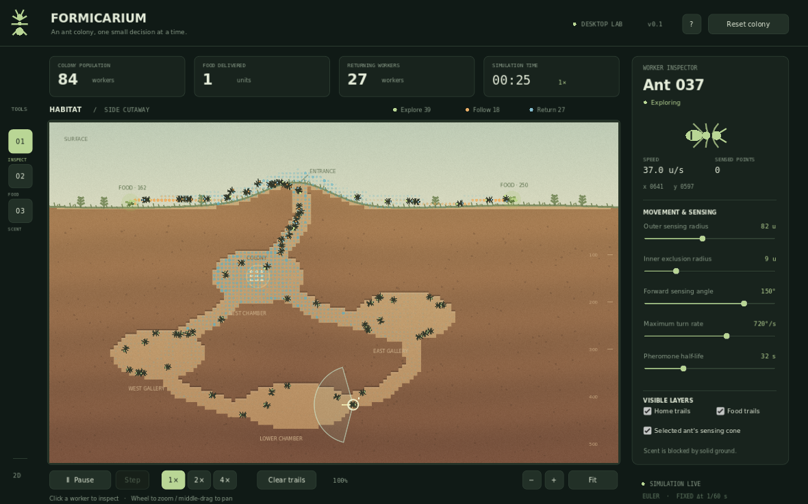

# Formicarium

A native **2D desktop ant colony simulator**, made with Godot 4.6 and typed
GDScript. The side cutaway shows an outdoor foraging corridor, the entrance,
four chambers and connecting tunnels. Every open map cell is walkable in any
direction. Solid ground blocks movement and pheromone attraction.

## Clone and run on Windows

Install [Git for Windows](https://git-scm.com/download/win) if you do not have
Git installed. Clone this repository and open its folder in PowerShell:

    git clone https://github.com/ARandomDog4708/Formicarium.git
    cd Formicarium
    .\run.cmd

The launcher downloads the official standard **Godot 4.6.3** engine on first
use, verifies its SHA-512 checksum, imports the project and opens the simulator.
The engine is cached under your local application data folder for later runs.
You can also double-click **run.cmd** in the cloned folder. Administrator
access and a separate Godot installation are not required.

To run the checks on Windows:

    .\run.cmd -RunTests

The simulation and application source files are directly editable in this
repository. To open the project in the Godot editor, install the standard
Godot 4.6+ editor, import **project.godot**, and press **F5**.

## Linux and macOS

Install the standard [Godot 4.6+ editor](https://godotengine.org/download/).
With Godot on your PATH:

    ./launch.sh

Or import **project.godot** in the editor and press **F5**. No .NET runtime,
plugins, or other packages are needed.

## Controls

| Control | Action |
| --- | --- |
| Space | Pause / resume |
| N / Step | One 1/60-second simulation step while paused |
| 1 / Inspect | Click a worker to select it |
| 2 / Food | Click walkable space to add 120 food units |
| 3 / Scent | Click or drag to paint food pheromone |
| Shift + scent brush | Paint home pheromone |
| Mouse wheel | Zoom around the pointer |
| Middle mouse drag | Pan |
| 0 / Fit | Fit the habitat |
| R / Reset colony | Restart the same seeded colony |
| H / ? | Controls guide |
| Escape | Close guide / return to inspection |

Use 1×, 2× and 4× to change the number of fixed simulation steps, independently
of the display frame rate. The inspector adjusts both radii, the forward
sensing angle, maximum turn rate and pheromone half-life. Layer switches
affect drawing only. The selected worker's cone shows the sensing region;
lines to pheromone samples show which points actually pass visibility checks.

## The model

For a pheromone sample j, strength a, distance d, and unit direction u:

    contribution_j = a_j * speed / (1 + d_j / falloff_length) * u_j
    attraction = cap_length(sum(contribution_j), speed)

Samples qualify only if:

- inner_radius < distance <= outer_radius;
- they are inside the forward cone;
- the grid ray from ant to sample crosses no solid cells;
- they match the pheromone type for the ant's current mode.

The two channels share the exact same equation:

| Mode | Follows | Deposits |
| --- | --- | --- |
| Explore | Persistent wandering; can detect food trails | Home |
| Follow food | Food | Home |
| Return home | Home | Food |

Workers pick up food on contact, turn around within the turn-rate limit, and
carry one unit back to the nest. Deposits weaken with distance traveled from
their source. Samples combine repeated deposits in an 8-unit grid and decay
exponentially, with a default 32-second half-life. Food piles and the colony
emit local beacons; those obey the same radius, cone and wall checks.

Exploration is an explicit state. After delivery, a worker explores for three
seconds before reacquiring a food trail. A trail followed for 40 seconds
without finding food triggers six seconds of exploration. This lets workers
leave unproductive scent clusters. Food is still picked up on contact while
exploring.

The capped attraction is combined with forward persistence and capped again.
Local obstacle checks choose a clear heading. The actual heading changes by
at most turn_rate * dt, including food pickup and delivery turns.

    velocity = facing_direction * desired_speed
    next_position = position + velocity * dt

This is explicit Euler integration at dt = 1/60 s. A displacement crossing
solid ground is rejected. The default turn rate is 720 degrees/second. Ants
use local sensing only; no pathfinder or global destination vector directs
their foraging.

### Initial conditions

84 workers begin distributed through the nest, entrance and a small surface
patrol. Pheromone trails start empty. Two food piles hold 440 units total.
The random seed is 1847. Reset restarts this same setup.

## Source layout

- simulation/world.gd: binary occupancy, collision, supercover visibility,
  initial habitat and food sources.
- simulation/pheromones.gd: channel storage, deposition, decay and attraction.
- simulation/simulation.gd: ant states, mode transitions and fixed-step motion.
- app/habitat.gd: terrain, ants, pheromone overlays, zoom and habitat input.
- app/main.gd: native controls and inspection panel.
- tests/run_tests.gd: headless model checks and a three-minute colony run.

The model extends RefCounted and owns no scene nodes; the view reads it.

## Validation

Run ./run-tests.sh, or:

    godot --headless --path . --script res://tests/run_tests.gd
    godot --headless --path . --script res://tests/app_smoke.gd

Checks cover the attraction equation, speed cap, inner and outer radii,
forward angle, channel selection, zero-distance samples, wall occlusion,
diagonal corners, half-life decay, Euler motion, turn-rate limits, seeded
repeatability, food conservation and autonomous pickup/delivery. A three-minute
simulation also checks that ants remain in walkable space with finite state.
Application checks exercise pause/step, parameter controls, food placement,
both pheromone brush channels, zoom, reset and the controls guide.

## Export

Install the matching Godot export templates, then use Project → Export.
Presets for Windows x86-64 and Linux x86-64 are included. The same source can
also be exported to macOS using Godot's macOS preset and templates.

## First-version scope

This is a tunable colony sandbox. Terrain and tunnels are initially fixed;
digging, queens, brood behavior, reproduction, combat and a game economy are
future work. Trail behavior is intentionally an approximation rather than a
biologically calibrated model.

Project code is MIT licensed. Godot license and notices are included in
GODOT-LICENSE.txt and GODOT-COPYRIGHT.txt.
